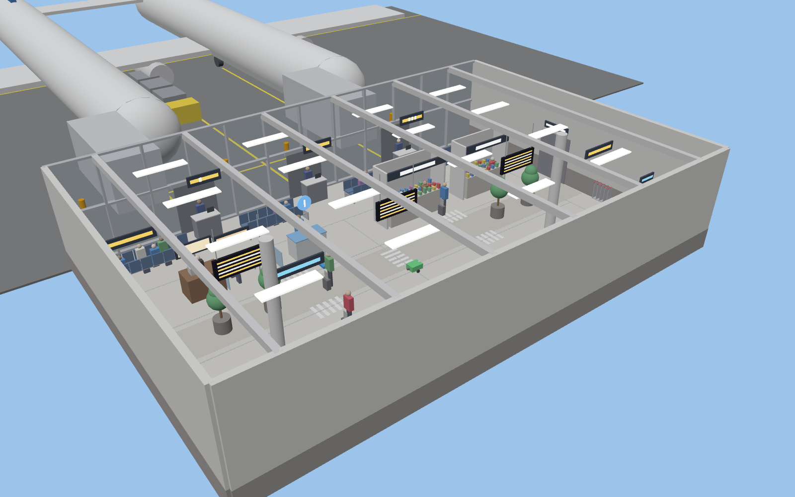
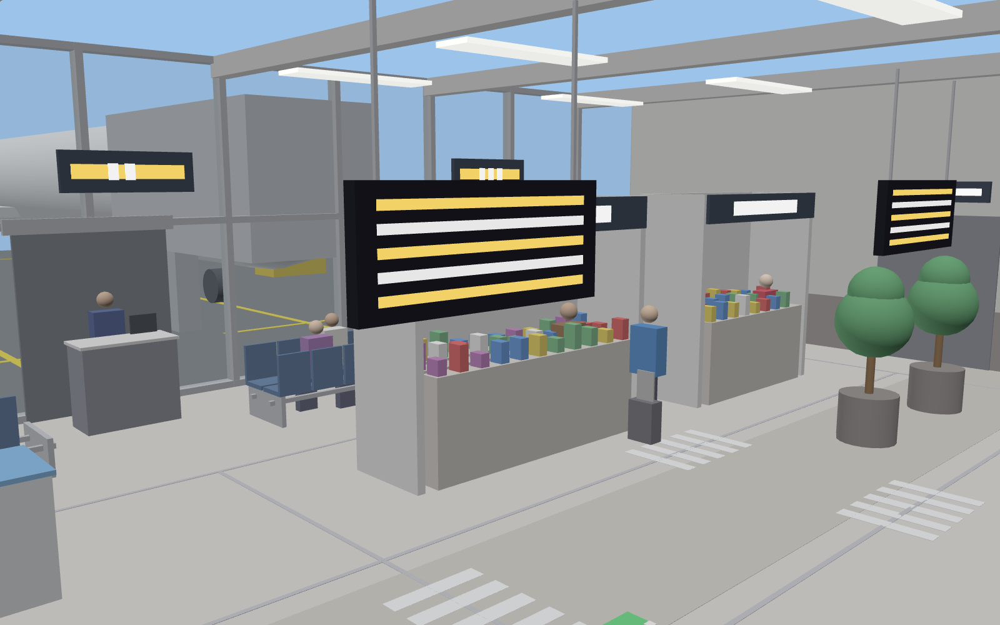
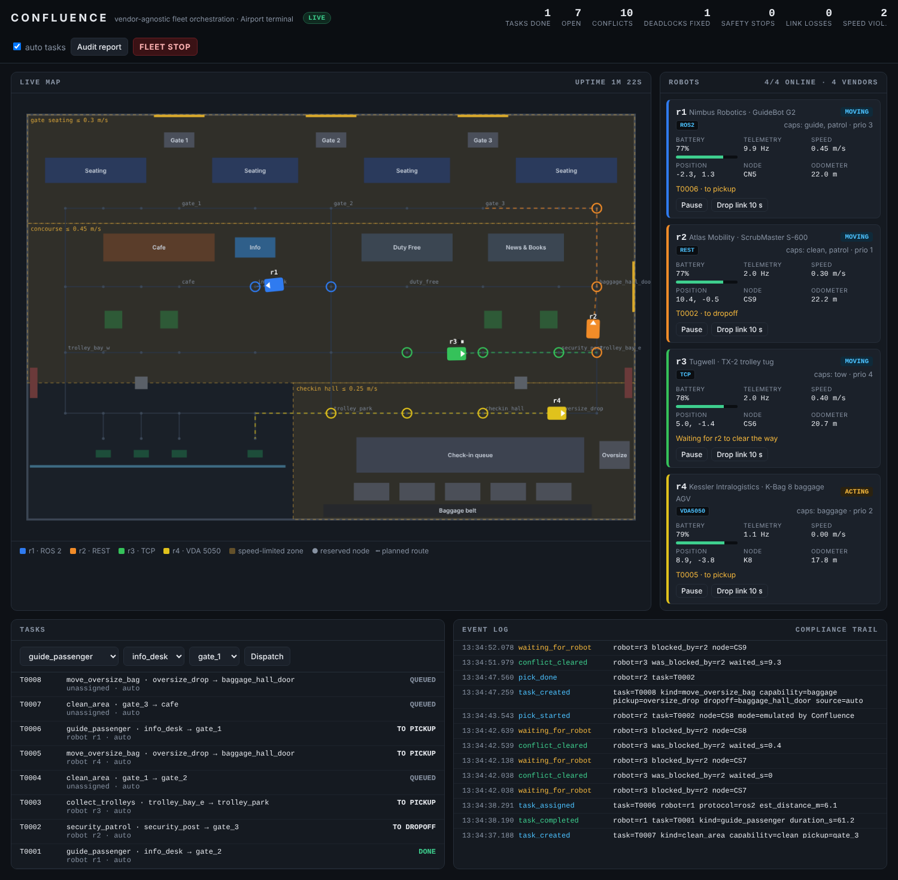

# Confluence — vendor-agnostic orchestration for heterogeneous robot fleets

Confluence controls robots from **different manufacturers that speak different
protocols** as one fleet. This package contains:

1. **`confluence/`**: the platform itself, a ROS 2 node with an integration
   layer, an orchestration engine, a compliance module and a web dashboard
2. **`confluence_sim/`**: Gazebo simulations of two sites, a **warehouse**
   and an **airport terminal**, with four robots from four (fictional)
   brands, each running its own simulated vendor software and API

Confluence never touches the robots' internals. It only uses each vendor's
published interface, exactly as it would with real hardware.



## Quick start: one command for everything

**First time** (from the unzipped folder):
```bash
bash confluence.sh start airport
```
This installs anything missing, builds the ROS 2 workspace, installs the
`confluence` command, starts Gazebo + robots + Confluence **in the
background**, waits until all 4 robots report in, prints their status and
opens the dashboard (`http://localhost:8080`).

**After that**, from any terminal (open a new one once so the command is found):

| Command | Does |
|---|---|
| `confluence start airport` | Start (Gazebo window). Also `warehouse`, and `headless` (no Gazebo window) or `lite` (no ROS/Gazebo at all) |
| `confluence shutdown` | Stop everything |
| `confluence restart` | Stop + start the same site/mode |
| `confluence status` | What every robot is doing |
| `confluence drive` | Keyboard control (1-4 pick robot, arrows move, g go to station, space stop, h home, q quit) |
| `confluence send r1 gate_3` | Send one robot somewhere (it switches to MANUAL) |
| `confluence jog r3 north` | Move one point; repeat the same direction to keep going |
| `confluence stop r2` · `pause r2` · `resume r2` | Stop at the next point · instant pause · continue |
| `confluence home r1` (or `all`) | Back to its charger, then back to automatic work |
| `confluence manual r4` · `auto r4` | Take a robot off / put it back on automatic tasks |
| `confluence task move_oversize_bag` | New task; Confluence picks the robot |
| `confluence assign T0007 r4` · `cancel T0007` | Give a task to a specific robot · cancel it |
| `confluence autotasks off` | Stop the automatic task generator |
| `confluence estop` · `release` | Fleet stop for every robot |
| `confluence stations` · `tasks` | Stations, robots and task kinds · task list |
| `confluence open` · `logs` · `doctor` | Dashboard · live log · checks everything and says what's wrong |

None of these need `source`, quoting or a particular folder. If
`confluence` isn't found, use `~/.local/bin/confluence` or open a new
terminal. `bash run_sim.sh airport` still works and does the same as `start`.

## Two sites, one Confluence

The **same Confluence code** runs both sites. Only the site map
(`confluence/sites/<site>.py`) and the fleet config
(`confluence/config/fleet_<site>.yaml`) differ, so the platform is
site-agnostic as well as vendor-agnostic.

| | Warehouse | Airport terminal |
|---|---|---|
| Size | 20 × 14 m | 24 × 16 m, plus apron outside |
| Areas | Racks, dock with conveyor, charging, packing | Gates with seating, concourse with cafe / info desk / shops, check-in hall with counters, queues and baggage belt, robot charging room |
| r1 · Nimbus (ROS 2) | Tote picker | **Guide robot** (screen mast): escorts passengers from the info desk to gates; security patrol |
| r2 · Atlas (REST) | Large AMR | **Floor scrubber**: cleans gate areas, cafe, check-in hall; security patrol |
| r3 · Tugwell (TCP) | Tugger | **Trolley tug**: collects luggage trolleys from the side bays |
| r4 · Kessler (VDA 5050) | Forklift AGV | **Baggage AGV**: oversize bags from the drop counter to the baggage hall |
| People | — | **Passengers walking** across the concourse. They are not robots and Confluence doesn't know about them; robots stop for them with their own lidar |
| Speed zones | Packing area, dock | Check-in hall 0.25 m/s, gate seating 0.3 m/s, concourse 0.45 m/s |

The airport world has glass windows with aircraft parked at jet bridges,
departure boards, gate podiums with agents, people sitting at the gates,
queuing at check-in and shopping, plus zebra crossings where people walk
across robot routes.




Supports Ubuntu 26.04 (ROS 2 Lyrical + Gazebo Jetty) and 24.04 (Jazzy +
Harmonic). The script installs `ros-<distro>-ros-gz`, `python3-yaml` and
`python3-paho-mqtt` if they're missing. No MQTT broker install is needed: a
small built-in one starts automatically if Mosquitto isn't running.

## Realistic behaviour

Jobs aren't instant. Each one has physical phases that take time, shown on
the dashboard as a label, a countdown and a progress ring round the robot:

| Job (airport) | At pickup | On the way | At dropoff |
|---|---|---|---|
| `guide_passenger` | greeting the passenger (~8 s) | escorting at walking pace (0.4 m/s), **passenger walks behind** | showing the gate (~7 s) |
| `clean_area` | lowering the brushes (~5 s) | scrubbing the floor at 0.2 m/s | emptying the tank (~9 s) |
| `security_patrol` | checking in at the post (~4 s) | on patrol | inspecting the area (~12 s) |
| `collect_trolleys` | coupling the trolleys (~10 s) | towing at 0.3 m/s | uncoupling (~8 s) |
| `move_oversize_bag` | loading the bag (~12 s) | carrying the bag | unloading (~10 s) |

- Times vary ±20 % from job to job. The warehouse has its own set (lifting a
  pallet, waiting for the picker, coupling a cart...). Edit `TASK_WORK` in
  `confluence/sites/<site>.py`.
- **After every job the robot stays put for 6-12 s** ("job done, pausing")
  before it takes the next job or heads home (`REST_AFTER_TASK`).
- The VDA 5050 robot performs its pick/drop as a native action with that
  duration; for the other brands Confluence holds the robot for the duration.

**The guided passenger.** A passenger (yellow) waits by the info desk. When
the guide robot arrives it greets them, switches to its *escort mode* through
its own API, and the passenger walks ~1.2 m behind it to the gate. If the
passenger falls more than 2.4 m behind, **the robot stops and waits** (its own
behaviour, not Confluence's). At the gate the passenger steps off the lane,
stays a while, then walks back to the desk as the next passenger. The
dashboard shows the passenger behind the robot (from the robot's rear sensor
reading), and you can watch it in Gazebo.

Other people: four passengers walk across the robot lanes at different
paces, pausing at the ends; robots stop for them with their own lidar.

## The fleet: 4 brands, 4 protocols (both sites)

| Robot | Brand / model (fictional) | Interface | Telemetry | Units / quirks | Speed cap? | Does |
|---|---|---|---|---|---|---|
| r1 | Nimbus Robotics | **ROS 2 topics** | push 10 Hz | m, rad; battery 0..1 | yes | totes / guiding, patrol |
| r2 | Atlas Mobility | **REST/HTTP** :8081 | must poll (2 Hz) | mm, degrees; text states | yes | totes, bins / cleaning, patrol |
| r3 | Tugwell | **TCP line protocol** :9090 | push 2 Hz | cm, compass heading (0 = north, clockwise), battery in **volts** | **no** | carts / trolleys |
| r4 | Kessler Intralogistics | **VDA 5050 v2 / MQTT** :1883 | ~1 Hz + on change | orders, node actions, order updates | yes (edge maxSpeed) | pallets / oversize baggage |

Each robot also has its **own onboard behaviour**: local navigation, a lidar
protective field that stops it, battery drain, and docking/charging.
Confluence can't override any of that.

## How Confluence maps to the project's four components

| Component | Where | What it does in this demo |
|---|---|---|
| **Robot integration layer** | `confluence/adapters/` | One adapter per protocol converts every vendor's units, frames, state names and update rates into one `RobotState` schema (`model.py`). Measures each robot's real telemetry rate and marks it OFFLINE when data goes stale. |
| **Orchestration engine** | `confluence/orchestrator.py` | Assigns tasks by **capability + travel cost + battery**. Plans routes on the site roadmap (`site.py`). Traffic control uses **node reservations**: a robot only drives into map nodes reserved for it, like railway signal blocks. **Resolves deadlocks**: the lower-priority robot re-routes or pulls aside. Sends robots home to charge. Holds reservations when a robot's link drops. |
| **Monitoring & compliance** | `confluence/compliance.py` | Append-only JSONL event log. Speed-zone checks on live telemetry. Flags robots whose interface **can't** take a speed cap. **Audit report** in HTML. |
| **Web dashboard** | `confluence/dashboard/` | Live map with routes and reservations, robot cards, dispatching tasks, pause/resume, **simulate link loss**, fleet stop, audit report. Backed by a JSON API, so a React front end can replace it. |

**Constraints respected:** commands go only through vendor interfaces; robot
software is never modified; a robot's own safety stop is never overridden.

## Controlling robots individually

Every robot can be taken off automatic work and driven on its own, from the
dashboard, the keyboard, or ROS 2. It's like taking one car off autopilot:
you steer, but Confluence still runs the traffic lights (node reservations),
so a hand-driven robot can't be driven into another one, and the robot's
own safety system still applies.

| Mode | Behaviour |
|---|---|
| **AUTO** (default) | Confluence assigns it tasks and parks it at its charger when idle |
| **MANUAL** | Only moves when you tell it to; stays where you leave it; never gets auto tasks |

Sending a robot somewhere switches it to MANUAL. **Home** sends it back to its
charger and back to AUTO. If you park a manual robot in a busy lane, other
robots detour round it, and the log suggests moving it.

**Dashboard** (`http://localhost:8080`):
- Click a robot (on the map or its card header) to select it, then **click
  anywhere on the map** to send it there. It drives to the nearest roadmap node.
- On each card: **AUTO / MANUAL** switch, **Go to** a station, **jog arrows**
  (one node per press, presses queue up), **Stop** (at the next node),
  **Pause/Resume** (instant), **Home**.
- Keyboard with a robot selected: arrow keys jog, space stops, Esc deselects.
- Tasks list: give a queued task to a **specific robot** (`→ r2` buttons; only
  robots with the right capability are offered) or cancel it (`✕`).

**Keyboard** (like `teleop_twist_keyboard`, but safe):
```bash
confluence drive
#  1-4 select robot · arrows/WASD move one point · g go to station · space stop
#  p pause/resume · h home · m manual/auto · q quit
```

**Behaviour you can rely on:**
- A new command takes effect **immediately**. A moving robot doesn't finish
  its old route first; at most it completes the point it's already driving into.
- Arrow keys: the same arrow again extends the move; the opposite arrow turns it back.
- A robot in its charger backs out to the lane first.
- Destinations that can't work are refused with a reason: another robot's
  charger, or a spot occupied by a parked/paused robot.
- **Home** goes straight home (no detours for tasks), then rejoins automatic work.
- The VDA 5050 forklift/baggage AGV gets a proper `cancelOrder` before a new
  order, as the standard requires.

**ROS 2**, one set of topics per robot:
```bash
ros2 topic pub --once /confluence/robots/r3/command std_msgs/String "data: 'goto trolley_park'"
ros2 topic pub --once /confluence/robots/r3/command std_msgs/String "data: 'jog north'"
ros2 topic pub --once /confluence/robots/r3/command std_msgs/String "data: 'home'"
ros2 topic echo /confluence/robots/r3/state
# RViz "2D Goal Pose" (or any PoseStamped) on /confluence/robots/r1/goal_pose drives r1 there
```

**HTTP API** (for scripts or a React front end): `POST /api/robot/<id>/goto`
`{"target": "gate_2"}` or `{"x": 3.0, "y": -1.4}`; `/jog` `{"direction": "north"}`;
`/stop`, `/home`, `/pause`, `/resume`, `/mode` `{"mode": "manual"}`; and
`POST /api/task/<id>/assign` `{"robot": "r2"}`.

## ROS 2 interface

Confluence runs as a ROS 2 node (`ros2 run confluence_sim confluence`):

```bash
# live fleet state (JSON, 2 Hz) and the event stream
ros2 topic echo /confluence/fleet_state
ros2 topic echo /confluence/events

# dispatch a task from any ROS 2 node
ros2 topic pub --once /confluence/task_request std_msgs/String \
  "data: '{\"kind\": \"move_pallet\", \"pickup\": \"dock_west\", \"dropoff\": \"rack_aisle_e\"}'"

# commands
ros2 topic pub --once /confluence/command std_msgs/String "data: 'goto r2 gate_1'"
ros2 topic pub --once /confluence/command std_msgs/String "data: 'assign T0004 r2'"
ros2 topic pub --once /confluence/command std_msgs/String "data: 'pause r2'"
ros2 topic pub --once /confluence/command std_msgs/String "data: 'resume r2'"
ros2 topic pub --once /confluence/command std_msgs/String "data: 'linkloss r4 10'"   # degraded comms test
ros2 topic pub --once /confluence/command std_msgs/String "data: 'estop'"
ros2 topic pub --once /confluence/command std_msgs/String "data: 'release'"
ros2 topic pub --once /confluence/command std_msgs/String "data: 'report'"          # write audit report
```

Task kinds per site:
- **Warehouse:** `move_pallet` (forklift), `pick_tote` (r1/r2), `deliver_bin` (r2), `tow_cart` (tugger)
- **Airport:** `guide_passenger` (r1), `clean_area` (r2), `security_patrol` (r1/r2),
  `collect_trolleys` (r3), `move_oversize_bag` (r4)

With `auto_tasks: true` in the fleet config, a steady stream of tasks is generated.

## Demo script (what to show your guide)

1. **Run** `confluence start airport` (first time: `bash confluence.sh start airport`). Gazebo opens, robots and passengers
   spawn, then Confluence registers each robot over its own protocol (see
   the event log).
2. **Heterogeneous control:** point at the robot cards. Same schema, but
   telemetry at 10 / 2 / 2 / 1 Hz from four different protocols.
3. **Task allocation:** dispatch `move_oversize_bag`. Only the baggage AGV is
   eligible, so it gets it. Dispatch `security_patrol`, and the nearer of the
   guide robot and the scrubber wins.
4. **Conflict resolution:** watch for "waiting for r3" on a card and
   `deadlock_resolved` in the log, as one robot re-routes or pulls aside.
5. **Degraded comms:** click **Drop link 10 s** on r4. It goes OFFLINE, its
   reserved nodes stay blocked so nobody drives into it, then it recovers.
6. **Fleet stop:** click **FLEET STOP**. All four brands stop via their own
   pause commands. Click again to release.
7. **Realism:** dispatch `guide_passenger`. The guide robot greets the
   passenger, who then walks behind it to the gate; watch the countdown on its
   card, then the pause after the job.
7b. **Drive one robot yourself:** click r3 on the map, set it to MANUAL, and
   click a spot. It drives there through traffic while the others keep
   working. Jog it with the arrow keys, then click **Home**.
8. **People:** watch a robot stop for a passenger crossing its path
   (`vendor_safety_stop` in the log). That's the robot's own lidar, which
   Confluence never overrides.
9. **Compliance:** open **Audit report**. The TCP tug shows up as unable to
   accept speed caps, and its speed-zone violations are listed.
10. **Same software, new site:** run `confluence start warehouse`.
   Nothing in Confluence changed.

## Adding a real robot or a new brand

1. Same protocol as an existing one (e.g. another VDA 5050 AGV): add an entry
   to `confluence/config/fleet.yaml` with its endpoint and capabilities. Done.
2. New protocol: write `confluence/adapters/<proto>.py` subclassing
   `RobotAdapter` (`start`, `drive`, `cancel`, `pause`, `resume`, and call
   `self._received(...)` with normalized fields), then register it in
   `adapters/__init__.py`.
3. New site: add `confluence/sites/<name>.py` (roadmap lanes, stations,
   chargers, speed zones, task templates) and `config/fleet_<name>.yaml`, and
   list it in `site.AVAILABLE`. For Gazebo, add a world builder like
   `confluence_sim/world_airport.py`.

## Files

| Path | Purpose |
|---|---|
| `confluence/site.py` | Active site map: roadmap graph, routing, stations, chargers, speed zones |
| `confluence/sites/` | Site definitions: `warehouse.py`, `airport.py` (incl. task templates) |
| `confluence/model.py` | Unified schema (`RobotState`, `Task`) |
| `confluence/adapters/` | `ros2.py`, `rest.py`, `tcp.py`, `vda5050.py` |
| `confluence/orchestrator.py` | Allocation, planning, reservations, deadlocks, charging |
| `confluence/compliance.py` | Event log, rule checks, audit report |
| `confluence/dashboard/` | Web UI + JSON API |
| `confluence/ros_node.py` | ROS 2 node wrapper (fleet + per-robot topics) |
| `confluence/teleop.py` | Keyboard control of individual robots through Confluence |
| `confluence/config/fleet_<site>.yaml` | Which robots exist and how to reach them, per site |
| `confluence_sim/vendors/` | Simulated vendor software and APIs (+ built-in MQTT broker, walking passengers) |
| `confluence_sim/world_gen.py` | World generator + warehouse builder; `world_airport.py` builds the terminal |
| `confluence_sim/fleet_config.py` | Gazebo robot and passenger models (body, wheels, lidar, per-site styling) |
| `launch/confluence.launch.py` | Full system; `launch/sim.launch.py` is Gazebo only |

Logs and audit reports are written to `~/.ros/confluence/`. Generated worlds
go to `~/.ros/confluence_<site>.sdf`; pre-generated copies are in `worlds/`.

## What was tested

Using the 2-D simulator (all four real protocol stacks over sockets/MQTT, with
Confluence driving them), checked every 0.1 s against robot footprints:
- **Warehouse**, 5.5 min of heavy traffic: **0 collisions**, 3 deadlocks
  resolved, a 10 s comms loss survived, fleet stop/release worked.
- **Airport**, 5 min with 3 passengers walking: **0 collisions, 0 contact
  with people**, 4 safety stops for passengers by the robots themselves, and 3
  deadlocks resolved (re-route and pull-aside).
- Every roadmap edge and turn clears the generated buildings on both sites
  (geometry check), and the airport world was rendered in 3D to check it. The
only compliance findings came from the tugger, whose protocol can't carry a
speed cap. The ROS 2 node paths (topics in/out, the ROS-native robot, Gazebo
odom/cmd_vel bodies) were exercised with a stand-in for rclpy. Real Gazebo
was not available on the build machine, so your laptop is the first full
Gazebo run.

## Troubleshooting

| Symptom | Fix |
|---|---|
| Anything odd | `confluence doctor` checks ROS, packages, build, ports, processes and the dashboard, and says what to fix |
| Dashboard won't open | `confluence start` waits until it's up; if it reports a port in use, close that program or reboot. Or use another port: `CONFLUENCE_PORT=8090 confluence start airport` |
| It stopped while starting | It prints the last lines of the log; full log: `confluence logs` |
| A robot won't go somewhere | Read the ✗ message: the spot may be another robot's charger or occupied by a parked robot. Move that robot or pick another spot |
| A robot stays OFFLINE | Its vendor software didn't start: look for `[vendor_robots]` errors. Ports 8081, 9090, 1883 must be free |
| Robots spawn but never move | `ros2 topic hz /r1/odom` should be ~20 Hz; if not, the bridge didn't start |
| Gazebo is slow | Use `bash run_sim.sh headless`, or set `<visualize>false</visualize>` for the lidar in `fleet_config.py` |
| Robots stop with "safety stop" | That's the robot's own lidar seeing something closer than 0.45 m; it resumes when clear |
| Want to try without Gazebo | `bash run_sim.sh airport lite` |
| Airport is slow in Gazebo | It's the larger world (~850 parts + aircraft). Use `headless`, or turn off shadows in `world_gen.py` (`<shadows>false</shadows>`) |
